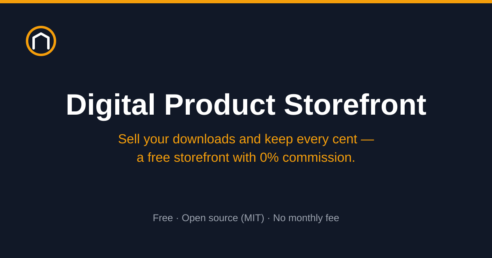

# Free Digital-Product Storefront 🛍️



[](https://github.com/mrabr381/digital-product-storefront/actions/workflows/ci.yml)


**Sell downloads with 0% commission.** A static storefront for digital
products — product pages, a cart, checkout through your own Stripe Payment
Links or PayPal buttons, and demo-grade license keys. No monthly fee, no
per-sale cut, no account, no tracking. Host it free on GitHub Pages.

> **🛒 [Try the live demo store](https://mrabr381.github.io/digital-product-storefront/)**
> — the store itself is the demo, live right now. All three products in it
> are clearly labelled **sample products**: they are not real products for
> sale. Swap them for yours with `python -m storefront add-product`.

## What it is

A plain HTML/CSS/JS storefront with no framework and no build step:
**product grid + detail pages** (cover art, description, features,
format, price) · **cart** (add, remove, change quantities — totals in
integer cents, so `$19.00 + $29.00` is exactly `$48.00`) · **checkout via
your own links** (Stripe Payment Link + PayPal button per product; buyers
pay you directly) · **license keys (demo-grade)** in the format
`XXXX-XXXX-XXXX-XXXX` · **a tiny CLI** (`python -m storefront
add-product` scaffolds a page + cover, so you never hand-edit HTML).

Everything is static: no server, no database, no API key, and nothing
leaves the buyer's browser except the payment itself (on Stripe's /
PayPal's own site).

## What you keep: Gumroad vs this store

Gumroad charges **10% + $0.50 per sale** (their published fee). This store
charges **0%** — you only pay your payment processor's own fee on top.

| Sale | Gumroad fee (10% + $0.50) | You keep (Gumroad) | You keep (this store) |
|------|---------------------------|--------------------|-----------------------|
| E-book — $12.00 | $1.70 | $10.30 | **$12.00** |
| Notion template — $19.00 | $2.40 | $16.60 | **$19.00** |
| Lightroom presets — $29.00 | $3.40 | $25.60 | **$29.00** |
| All three — $60.00 | $7.50 | $52.50 | **$60.00** |

Maths, checked by hand: 10% of $29.00 is $2.90, plus $0.50 is $3.40;
$29.00 − $3.40 = $25.60. "You keep" means before your payment
processor's own fee (the same on both, so the difference above is real).

## Quickstart

No dependencies — Python 3.10+ only, standard library.

```bash
git clone https://github.com/mrabr381/digital-product-storefront.git
cd digital-product-storefront
python scripts/make_sample.py   # regenerate the sample store (optional)
python -m http.server 8000       # open http://localhost:8000
```

Browse the store, add the three sample products to the cart, change
quantities — the total updates instantly (cart lives in `localStorage`).

## Adding a product

```bash
python -m storefront add-product --name "My Preset Pack" --price 15 \
  --tagline "Five presets for golden-hour portraits." \
  --description "Longer pitch goes here." --format "5 × .xmp + 5 × .dng + PDF guide" \
  --features "5 presets, Desktop + mobile, Install guide, Free updates"
```

This appends the product to `products.json`, generates a matching cover SVG
(colours picked deterministically from the name), and rebuilds `index.html`
and `products/<slug>.html`. Then replace the placeholder checkout links in
`products.json` (`stripe_link` / `paypal_link` `REPLACE-ME` values). Other
commands: `python -m storefront build` · `python -m storefront list`.

## Going live: Pages + real payments

**1. GitHub Pages (2 minutes, free).** Repo Settings → Pages → Source:
*Deploy from a branch* → branch `main`, folder `/ (root)` → Save. Live at
`https://mrabr381.github.io/digital-product-storefront/`.
**2. Stripe Payment Links (free, no code).** Stripe Dashboard → Payment
Links → Create payment link → copy the `https://buy.stripe.com/...` URL
into the product's `stripe_link` in `products.json` → `python -m
storefront build` → commit and push. Each product needs its own link.
**3. PayPal (free).** PayPal.Me link (or a PayPal button) into the
product's `paypal_link`, e.g. `https://www.paypal.com/paypalme/YOURNAME/15`.
**4. Delivering the files.** This store does not host file delivery: after
a buyer pays, Stripe / PayPal emails you their address; you email the
download link (host the files on Google Drive or your own server).
Automatic delivery is out of scope for this static store, by design.

## How checkout and license keys work

- **Checkout:** the "Buy with Stripe" / "Buy with PayPal" buttons are plain
  links to the URLs in `products.json`. Until you replace the `REPLACE-ME`
  placeholders, they go nowhere useful — the product page says so.
- **Cart:** a convenience for browsing totals — there is no combined
  checkout. Each product is paid for on its own Payment Link.
- **License keys:** the "Generate demo key" button makes a random key in the
  format `XXXX-XXXX-XXXX-XXXX` (no confusing `0`/`O`/`1`/`I`). **Demo-grade,
  not DRM** — anyone can generate one, and nothing checks it.

## Honest limitations

- **No real payment processing in this repo.** Checkout is links only;
  Stripe / PayPal handle the money on their own sites.
- **No automatic file delivery** — delivery is manual (email) unless you
  add it. See "Delivering the files" above.
- **License keys are demo-grade.** Not checked against anything, not
  copy protection.
- **No combined cart checkout, no analytics, no accounts, no order
  history.** The trade-off for 0% fees and no server: for order tracking,
  use Stripe's dashboard (it logs every Payment Link sale).
- **The three products in the demo store are samples, not real products.**
  The Notion template, presets and e-book do not exist as real files —
  they demonstrate the flow. Every product card and page says so; replace
  them with your own products before selling anything.
- **Covers are simple SVG art**, not product photography. Swap in your own
  images (JPG/PNG) via the `cover` path in `products.json` — binary images
  cannot be pushed with the usual GitHub connector workflow; upload them
  through the GitHub web UI instead.

Layout: `index.html` + `products/*.html` (generated) · `products.json`
(the catalogue — edit this) · `assets/` (`style.css`, `store.js`,
`covers/*.svg`) · `storefront/` (`cli.py`, `generate.py`, `sample.py`) ·
`scripts/make_sample.py`.

MIT — see [LICENSE](LICENSE). Issues and pull requests are welcome: no
invented prices or fees, every fee quoted must come from the vendor's own
pricing page, and every new feature must be testable with
`python -m http.server` and `curl`.
